# AWS DMZ VPC with Terraform

A three-tier DMZ network on AWS, built first in the console and then rewritten as Terraform. Public-facing components sit in a DMZ, application servers and the database are in private subnets with no public IPs, and every tier is isolated by security groups, network ACLs and route tables. Admin access uses AWS Systems Manager Session Manager instead of SSH.

Region: `ap-south-1` (Mumbai), two Availability Zones.

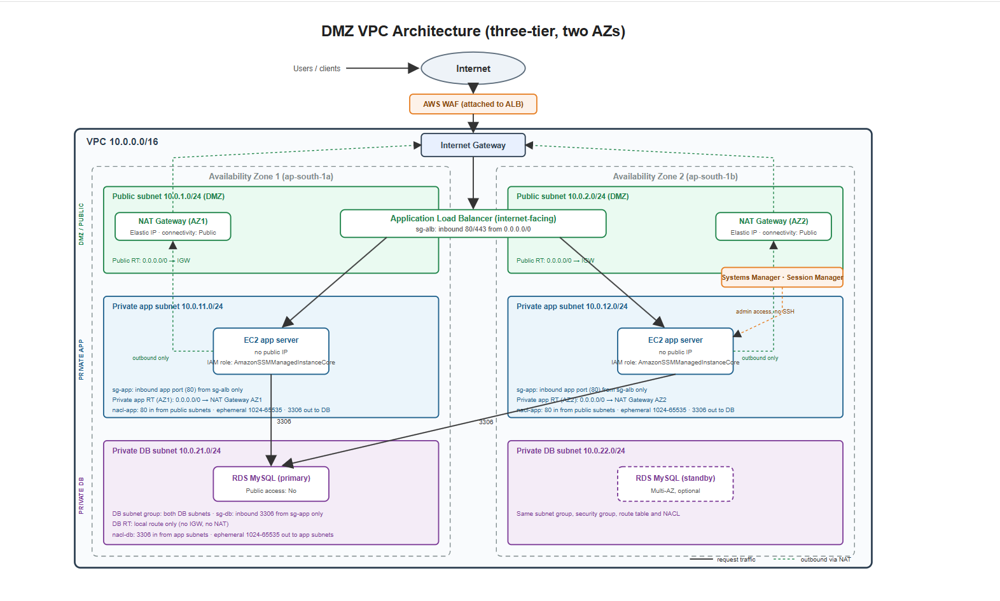

## Architecture

| Tier | Subnets | Contents | Internet path |
|---|---|---|---|
| DMZ / public | 10.0.1.0/24, 10.0.2.0/24 | Application Load Balancer, NAT Gateway per AZ | Internet Gateway |
| Private app | 10.0.11.0/24, 10.0.12.0/24 | EC2 app servers (Amazon Linux 2023, Apache), no public IP | Outbound only, via NAT in the same AZ |
| Private DB | 10.0.21.0/24, 10.0.22.0/24 | RDS MySQL 8.0 | None |

Traffic is chained by security group reference rather than CIDR:

```
internet ──80/443──▶ sg-alb ──80──▶ sg-app ──3306──▶ sg-db
```

Network ACLs add a stateless layer on the app and DB subnets, with explicit rules for request traffic and ephemeral-port return traffic.

## Repository layout

```
versions.tf              Terraform and AWS provider version pins
variables.tf             inputs (region, CIDRs, instance sizes, DB settings)
vpc.tf                   VPC, subnets, IGW, NAT gateways, route tables
security_groups.tf       sg-alb, sg-app, sg-db
nacls.tf                 nacl-app, nacl-db
alb.tf                   ALB, target group, listener
ec2.tf                   IAM role for SSM, AMI lookup, app instances
rds.tf                   DB subnet group, RDS MySQL
outputs.tf               ALB DNS name, instance IDs, RDS endpoint, NAT IPs
terraform.tfvars.example sample variable values
screenshots/             console views and test evidence
```

## Deploy

```bash
git clone https://github.com/<your-username>/aws-dmz-vpc-terraform.git
cd aws-dmz-vpc-terraform
cp terraform.tfvars.example terraform.tfvars
export TF_VAR_db_password='<strong password, no / @ " or spaces>'

terraform init
terraform validate
terraform plan      # 59 resources
terraform apply     # ~15 minutes, RDS is the slow part
```

Test the web tier:

```bash
curl http://$(terraform output -raw alb_dns_name)
```

Open a shell on a private instance without SSH:

```bash
aws ssm start-session --target $(terraform output -json app_instance_ids | jq -r '.[0]')
```

Tear down:

```bash
terraform destroy
```

## Console views

Resource map of the VPC with subnets, route tables and gateways:

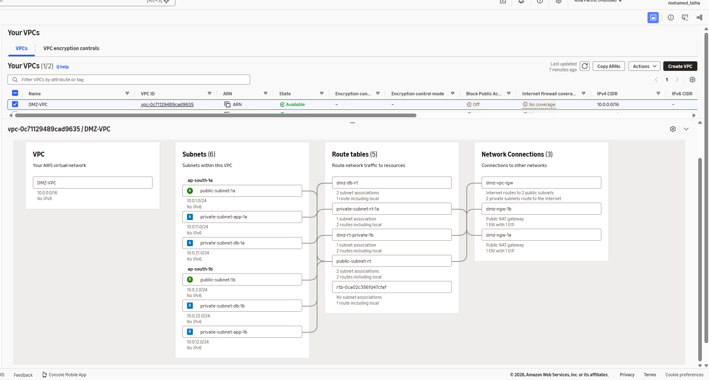

Route tables. Public subnets route to the Internet Gateway, each app subnet to the NAT Gateway in its own AZ, and the DB route table has only the local route:

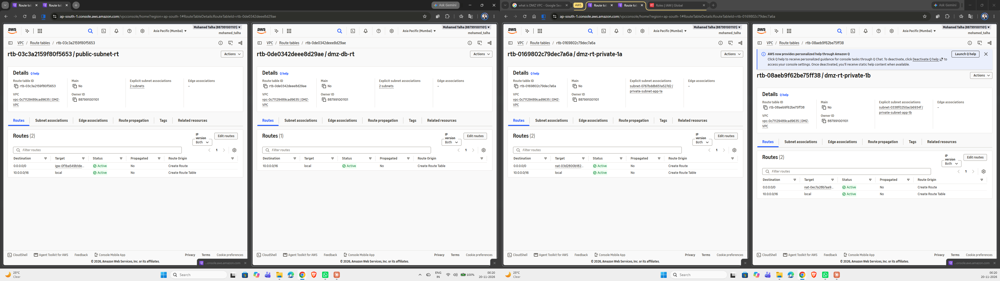
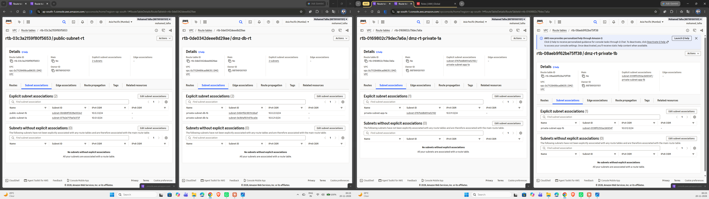

Security group inbound rules, each tier accepting traffic only from the security group in front of it:

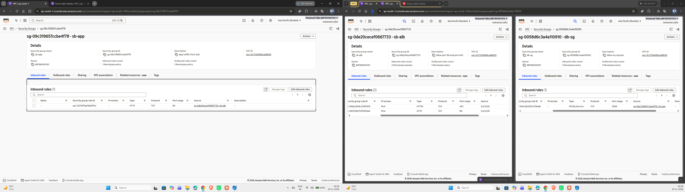

Network ACL rules and subnet associations:

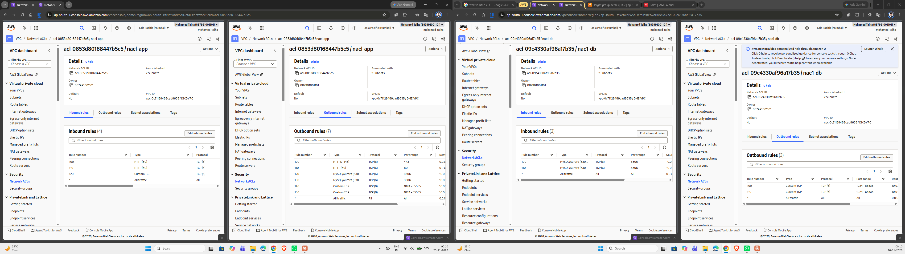
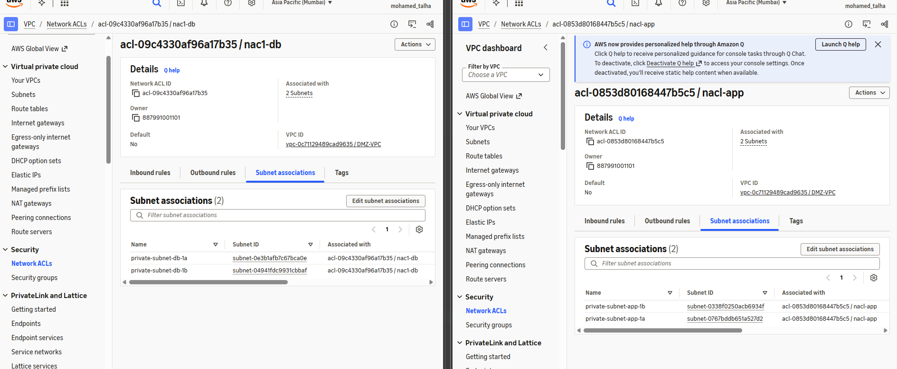

IAM role with `AmazonSSMManagedInstanceCore` attached to the app instances:

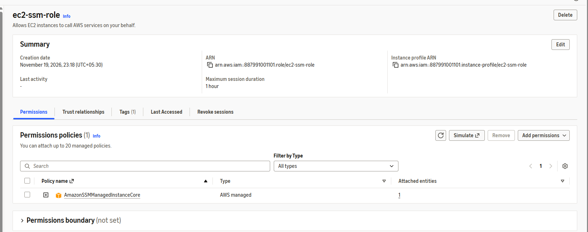

RDS instance and its DB subnet group spanning both private DB subnets:

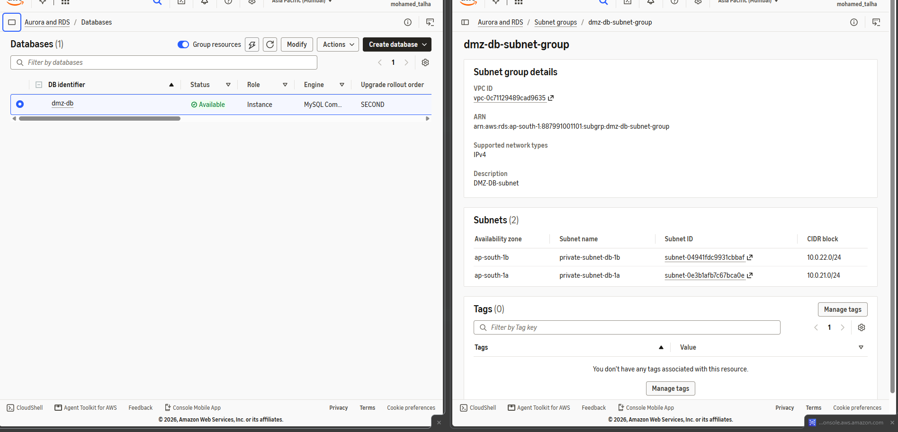

## Verification

Every test below was run against the deployed stack. Positive tests prove the intended paths work; negative tests prove the isolation holds.

### From the internet (run on local machine)

| # | Test | Expected | Result |
|---|---|---|---|
| 1 | `curl http://<alb-dns>` | Apache page from an app server | Pass |
| 2 | App servers have no public IP | `PublicIpAddress` is null | Pass |
| 3 | `nc -zv <rds-endpoint> 3306` from outside the VPC | Timeout | Pass |

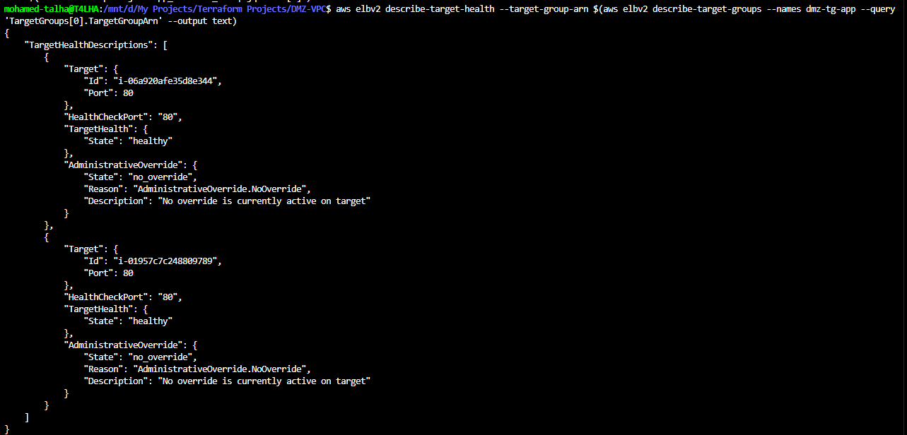

### Inside an app server (via Session Manager)

| # | Test | Expected | Result |
|---|---|---|---|
| 4 | Instance metadata shows no public IPv4 | Empty / 404 | Pass |
| 5 | `curl https://checkip.amazonaws.com` | Returns the NAT Gateway EIP for that AZ | Pass |
| 6 | `dnf install` succeeds | Outbound 443 via NAT works | Pass |
| 7 | `mysql -h <rds-endpoint> -u admin -p` | MySQL prompt | Pass |
| 8 | `nc -zv <rds-endpoint> 3307` | Timeout | Pass |
| 9 | `nc -zv <rds-endpoint> 22` | Timeout, no SSH into DB tier | Pass |
| 10 | `nc -zv <app1-private-ip> 80` from app0 | Timeout, sg-app only trusts sg-alb | Pass |

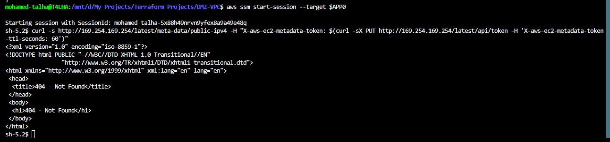

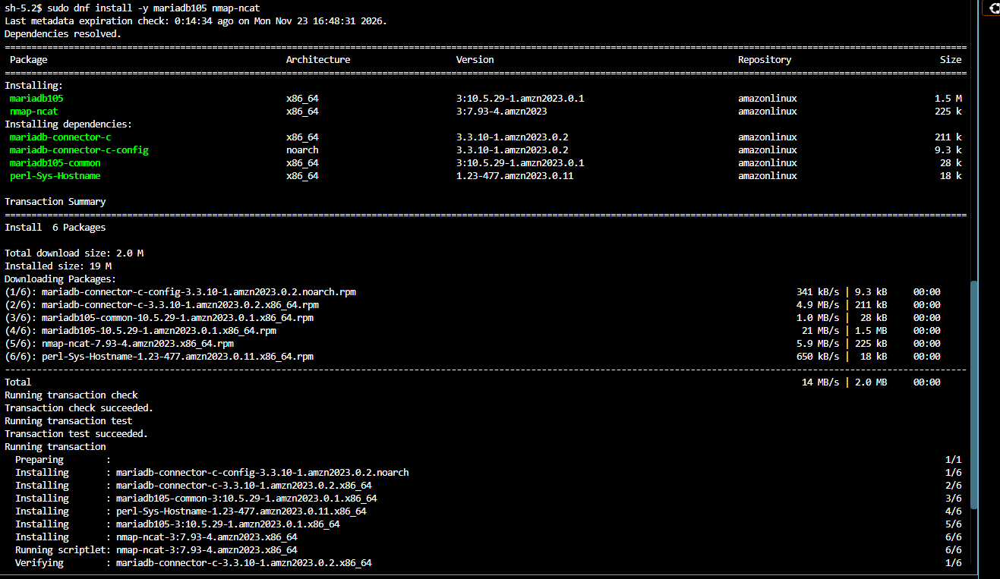
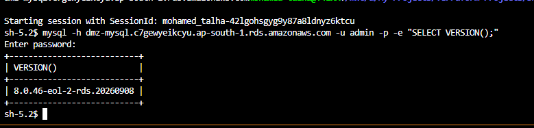
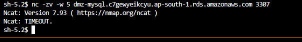
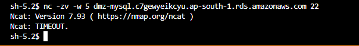
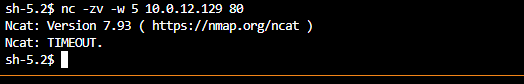

### Routing and NAT

| # | Test | Expected | Result |
|---|---|---|---|
| 11 | DB route table | Only `10.0.0.0/16 local`, no `0.0.0.0/0` | Pass |
| 12 | NAT failover: remove AZ2 NAT route, curl from app1 | Fails, app1 depends only on its own AZ's NAT | Pass |

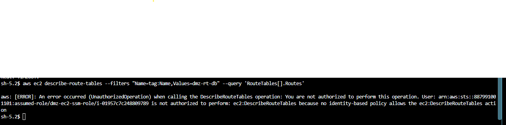
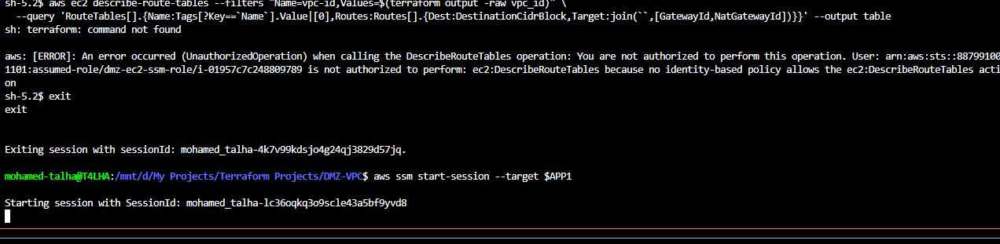

### Security group audit

| # | Test | Expected | Result |
|---|---|---|---|
| 13 | List all SG rules in the VPC | Only sg-alb has `0.0.0.0/0` inbound; sg-app and sg-db reference security groups | Pass |

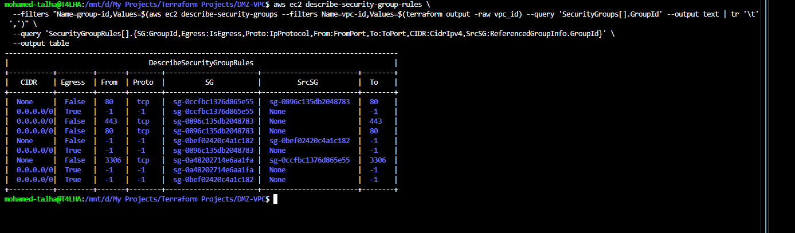

## Lessons learned

- Route tables are associated with subnets; the routes live inside the table. One table per AZ for the app tier avoids cross-AZ NAT traffic and a single point of failure.
- NACLs are stateless, so every connection needs a rule for the request and one for the ephemeral-port reply. Missing the reply rule is the usual cause of "unhealthy" ALB targets.
- `vpc_id` takes the VPC ID, not its CIDR. A copy-paste of `var.vpc_cidr` into `vpc_id` fails at apply time with `InvalidVpcID.NotFound`.
- Terraform does not recreate an instance when `user_data` changes. Set `user_data_replace_on_change = true`, or use `terraform apply -replace`.
- User data runs early in boot; `dnf` may not be ready. A retry loop and `mkdir -p` make the bootstrap script reliable.
- Files edited on Windows can carry CRLF line endings, which RDS rejects in a password as a control character. `git config core.autocrlf input` and LF in the editor avoid it.

## Possible improvements

- Replace the two instances with a launch template and Auto Scaling group
- HTTPS listener with an ACM certificate and HTTP to HTTPS redirect
- AWS WAF on the ALB with the AWS managed Core rule set
- RDS `multi_az = true` for a standby in the second AZ
- Remote state in S3 with DynamoDB locking
- VPC Flow Logs to CloudWatch for reject-traffic evidence
- Split into reusable modules (network, compute, database)
